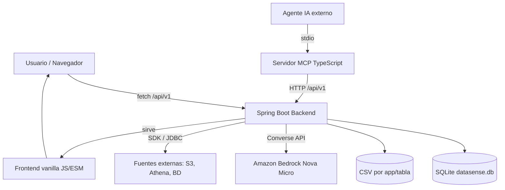
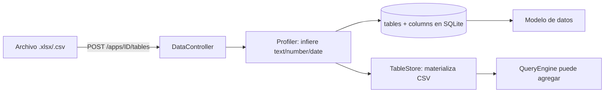
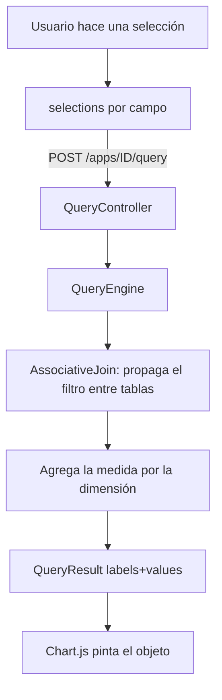
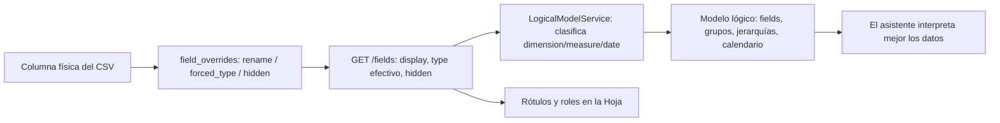
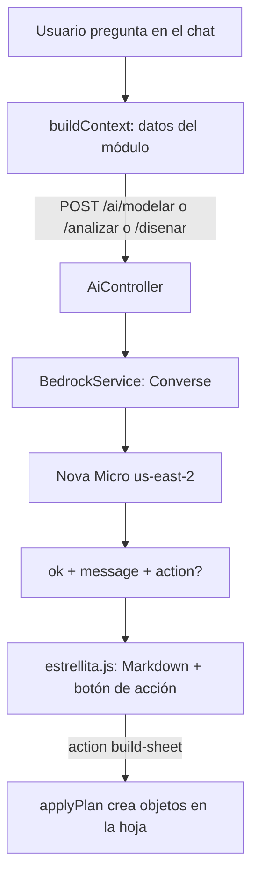
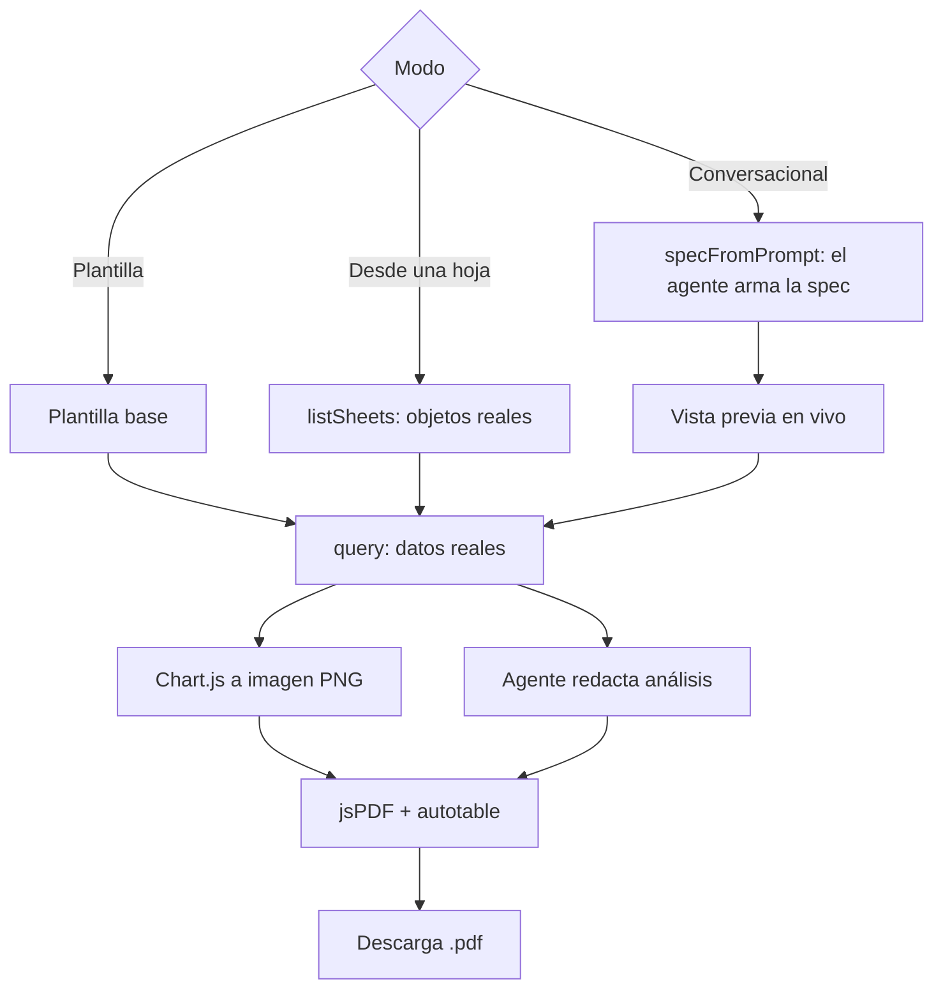
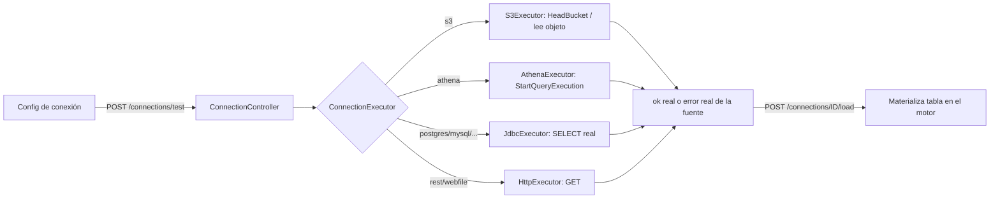
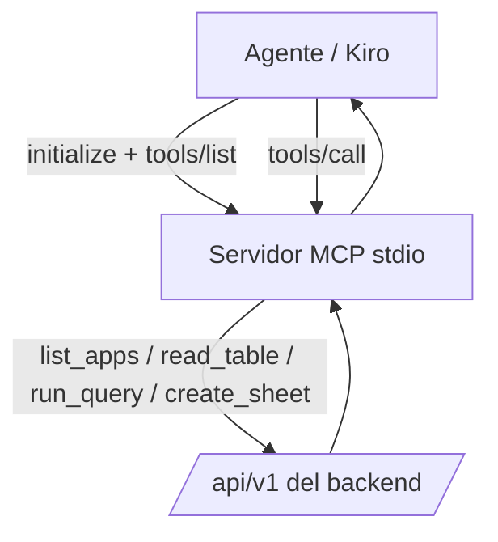
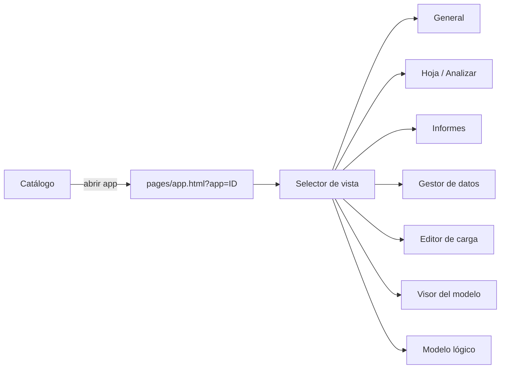
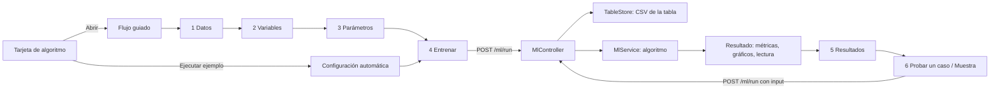

# Diagramas de flujo

Diagramas en [Mermaid](https://mermaid.js.org/) (se renderizan en GitHub y en editores compatibles).

## 1. Arquitectura general

## 2. Carga de datos (Excel/CSV)

## 3. Consulta asociativa (Hoja)

## 4. Capa de presentación: overrides y modelo lógico

## 5. Asistente de IA (estrellita)

## 6. Generación de informes PDF

## 7. Conexión de datos real

## 8. MCP (agente externo opera la plataforma)

## 9. Navegación de la app (router in-app)

## 10. Laboratorio de ML

